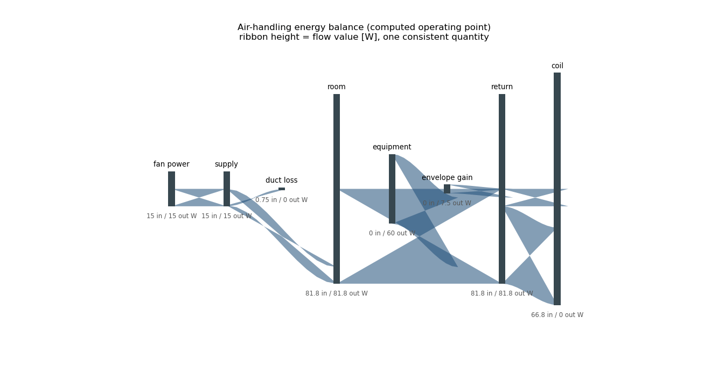

# 🗺️ Energy Flow Atlas

**Validated engineering flow tables and Sankey diagrams: an original Python utility — one consistent quantity per diagram, unit-stamped rows, internal-node conservation gates that name their worst offender, and geometrically verified ribbon proportionality — with a computed air-handling balance closing to 0.0 W and an explicitly labeled illustrative demo.**

[](https://github.com/khalil-official/energy-flow-atlas/actions/workflows/ci.yml)
[](LICENSE)
[](requirements.txt)

<div align="center">

**▶ Watch the system commission:**



<sub>41 frames — each frame is a fully re-balanced air-handling table at
that load fraction (internal nodes close at every step). Produced by
<code>examples/run_verification.py</code>.</sub>

</div>

## 🎯 Purpose and scope

A validation-first Sankey utility: the numbers are checked (non-negative,
finite, one unit, internal conservation) before anything is drawn, and
the drawing guarantees ribbon heights proportional to flow values under a
single scale factor. Illustrative data is labeled as such everywhere.
Scope: accounting-level flow diagrams; not a physics solver.

## 🧮 Conventions and guarantees

- One measurable quantity, one unit per table — mixing units raises.
- Direction lives in source→target; negative values are rejected with the
  offending row (no hidden sign conventions).
- `check()` closes internal nodes within tolerance and names the worst
  offender; external net sources/sinks are reported, never forced.
- Ribbon height = value × one global scale factor (test-verified
  geometrically); titles state the unit and any illustrative-data label.

Details: [docs/model.md](docs/model.md); API: [docs/api.md](docs/api.md).

## ⚡ Quick start

```bash
python -m pip install -r requirements-dev.txt
python -m pytest tests -q                       # 7 verification tests
python examples/run_verification.py             # figures + GIF + raw data
```

Verified: Python 3.13.5, Matplotlib 3.10.0, Windows 11; CI on Ubuntu.

## 🧱 Architecture and API

```
energy_flow_atlas/
├── flow_table.py      # validated FlowTable + balance accounting
└── render.py          # staged ribbon renderer (plain Matplotlib)
tests/test_flow_table.py
examples/run_verification.py
docs/ model.md  api.md  verification.md  results/
```

```python
from energy_flow_atlas import FlowTable, render_sankey

t = FlowTable("energy", "W", internal_nodes=("mid",))
t.add("heater", "mid", 100.0).add("mid", "load", 70.0).add("mid", "loss", 30.0)
t.check()          # raises unless 'mid' closes
render_sankey(t)
```

## 📊 Results and metrics

| Case | Metric | Value |
| --- | --- | --- |
| Engineering balance (8 rows, 5,220 W total) | max internal-node imbalance | **0.0 W (exact)** |
| Illustrative sample allocation | internal imbalance | 0.0 (balanced demo) |
| Ribbon proportionality (geometric test) | scale-factor spread | < 1e-10 |
| Commissioning animation | frames / balance | 41 / closes at every fraction |

Raw data: [docs/results/](docs/results) — `engineering_balance.csv`,
`illustrative_allocation.csv`, figures
[engineering_balance.png](docs/results/engineering_balance.png),
[illustrative_allocation.png](docs/results/illustrative_allocation.png),
animation `commissioning.gif`.

## ✅ Verification

Seven tests: value validation, exact balance + external-node reporting,
offender-naming imbalance errors, illustrative-label propagation,
hand-value totals, empty-table rejection, and the geometric
single-scale-factor proportionality check on the drawn artists. Evidence
and limits: [docs/verification.md](docs/verification.md).

## ⚠️ Limitations

- Accounting tool: does not model the physics producing the flows.
- One quantity per diagram; staged layout heuristic (cyclic tables may
  cross ribbons — numbers unaffected).
- The illustrative table is demonstration data by design.

## 📚 References

- Sankey diagram conventions (unit consistency, single-quantity widths).
- Matplotlib patches API (implementation basis).

Dependencies: NumPy (BSD-3), Matplotlib (PSF-based), Pillow (HPND),
pytest (MIT). This repository's own code is original and MIT-licensed;
see [LICENSE](LICENSE).
