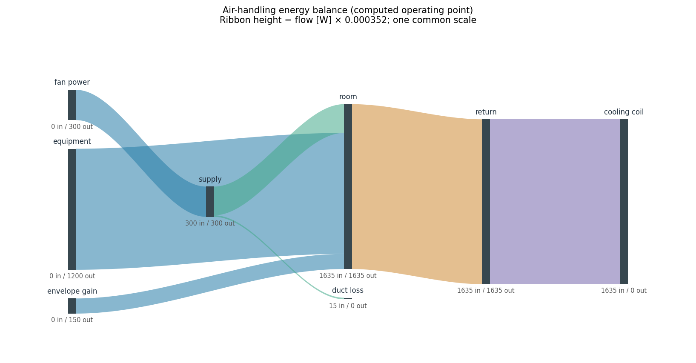
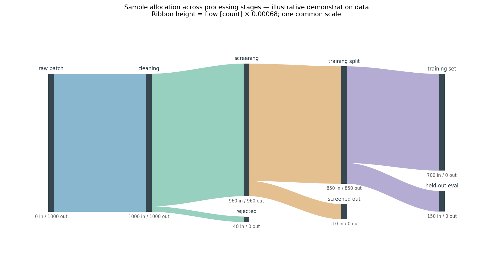

# 🗺️ Energy Flow Atlas

**Engineering Sankey diagrams whose geometry follows the energy ledger.**
Validate one quantity in one unit, check conservation at internal nodes,
and draw ribbons with a common physical scale. Includes a reproducible
air-handling heat balance, an animated load sweep and raw numerical tables.

[](https://github.com/khalil-official/energy-flow-atlas/actions/workflows/ci.yml)
[](LICENSE)
[](requirements.txt)

## ▶️ Watch the load change


[Open the animated GIF directly](docs/results/commissioning.gif) ·
[Frame-by-frame flow data](docs/results/commissioning_flows.csv)

The 41 frames increase rated input from 5% to 100%. The W-to-height scale
stays fixed, so a 50 W ribbon is half as thick as a 100 W ribbon across
frames. Every operating point is rebalanced. This is a sequence of steady
loads, not a simulation of startup dynamics. White background, no grid.

## 🎯 What this project does

- Rejects negative/nonfinite transfers, missing internal nodes and mixed units.
- Reports each node's inflow, outflow and residual; rendering checks conservation.
- Places nodes by graph connectivity, independently of input row order.
- Draws simple ribbons with the correct thickness throughout their length.
- Preserves an illustrative-data label even with custom titles.

This is a small accounting and visualization package, not an HVAC or CFD solver.
The renderer accepts directed acyclic graphs; cyclic ledgers can be checked
numerically but must be re-expressed before left-to-right rendering.

## ⚡ Run it locally

```bash
python -m venv .venv
# Windows: .venv\Scripts\activate
# Linux/macOS: source .venv/bin/activate
python -m pip install -r requirements-dev.txt
python -m pytest tests -q
python examples/run_verification.py
```

The verification script writes PNG/SVG figures, the GIF, node-balance CSVs,
all 287 animation transfers and a runtime/metrics JSON into `docs/results/`.
No external datasets, GPU or network connection are needed after installation.
Recorded runtime versions are in [run_summary.json](docs/results/run_summary.json).

## 🧮 A worked energy balance

The rated operating point supplies 300 W of fan work, 1,200 W of equipment
heat and 150 W of envelope heat gain. Five percent of fan work, 15 W, is
lost through the duct. The remaining 285 W enters the room:

```text
Supply: 300 = 15 + 285 W
Room:   285 + 1,200 + 150 = 1,635 W
Return: 1,635 = 1,635 W removed by the cooling coil
System: 300 + 1,200 + 150 = 15 + 1,635 = 1,650 W
```

Recirculating air is not a recovered source of electrical fan power. The
energy diagram therefore ends at coil heat removal and duct loss.



| Rated metric | Computed value | Interpretation |
| --- | ---: | --- |
| External power input | 1,650 W | Three independent sources |
| Cooling-coil removal | 1,635 W | All heat leaving the room |
| Duct loss | 15 W | 5% of 300 W fan input |
| Maximum internal-node residual | 0 W | Constructed ledger closes |
| Sum across the seven transfer edges | 5,220 W | Counts energy again at successive stages; **not** system input |
| Animation | 41 operating points | 5–100% rated input, fixed scale |

These are specified operating-point values, not measurements or a solved
thermodynamic model. [Model, equations and layout](docs/model.md).

## 🧱 Use the package

```python
from energy_flow_atlas import FlowTable, render_sankey

table = FlowTable("power", "W", internal_nodes=("converter",))
table.add("electrical input", "converter", 100)
table.add("converter", "useful output", 70)
table.add("converter", "loss", 30)
report = table.check()
assert report.imbalance["converter"] == 0
axis = render_sankey(table)
axis.figure.savefig("converter.png", facecolor="white", bbox_inches="tight")
```

[API and failure cases](docs/api.md) · [Step-by-step tutorial](docs/tutorial.md)

```text
energy_flow_atlas/flow_table.py  validation and conservation
energy_flow_atlas/render.py     graph staging and quantitative ribbons
examples/run_verification.py   reproducible figures, animation and tables
tests/test_flow_table.py        accounting and geometric regressions
docs/results/                  generated evidence
```

## 📊 A second, explicitly illustrative example



A constructed 1,000-sample batch loses 40 samples during cleaning and 110
during screening. The remaining 850 split into 700 training / 150 held-out
samples. All three internal processing nodes conserve **sample count**.
This is demonstration data; it is labeled on the diagram and in the CSV.

## ✅ Verification and practical limits

**23 tests pass**, including interior polygon cross-sections (not merely
endpoint widths), positive ribbon area, exact target-node connections after
edge reordering, correct node throughput, mixed-unit rejection, conservation
gates and fixed-scale load changes. See [verification details](docs/verification.md).

Layout is deterministic but does not optimize crossings. Distinct ribbons
can cross each other; each individual positive-flow ribbon is a simple
polygon. Very crowded graphs need a larger figure or smaller `node_gap`.
The finite/nonnegative/unit checks do not establish whether supplied data
are physically correct. Each diagram represents one extensive quantity;
use separate diagrams for heat, mass, money or sample counts.

## 📚 Implementation and license

Original package code under [MIT](LICENSE). Uses
[Matplotlib polygon artists](https://matplotlib.org/stable/api/_as_gen/matplotlib.patches.Polygon.html),
NumPy and Pillow; pytest runs the regression suite. Rendering uses sampled
cubic smoothstep flanks, not a third-party Sankey layout engine.

[Calendar metadata disclosure](docs/CALENDAR_HISTORY.md).
